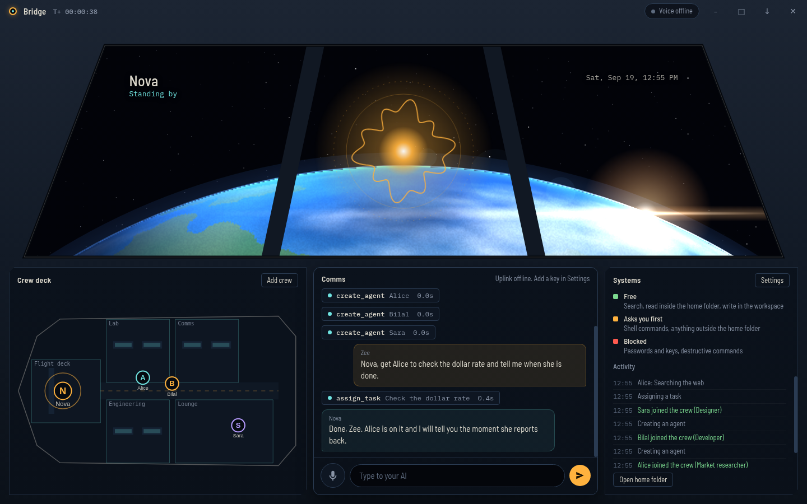

# Bridge

An always-on AI first officer that lives in its own space-shuttle world.
It talks with you in real time, uses your computer (with permission), and runs a crew of agents. Every agent is a folder.



## Run it

```
npm install
npm start
```

Needs Node 20+. On first start the ship asks you to **commission** it:

1. **Callsign** – what the AI is called (Jarvis, Nova, anything).
2. **Voice** – female or male, plus one of four Gemini voices. Gender also decides how it speaks about itself in Urdu.
3. **Commander** – your name and title (Commander, Boss, CEO, or your own).
4. **Uplink** – a Gemini API key from https://aistudio.google.com/apikey (stored only on your machine).
5. **Home base** – where the ship's folders live.

Then comes the launch: countdown, liftoff, ascent, orbit. Every later start skips the launch and goes straight to the bridge.
Rename the AI, change gender or voice any time in **Settings**, or recommission from scratch there.

## Always on

- Closing the window sends it to the **tray**; it keeps running.
- **Ctrl+Alt+J** wakes it from anywhere and opens the voice session.
- "Start when I sign in" (installed builds) launches it hidden in the tray.
- Voice sessions close themselves after 10 quiet minutes (configurable) so you are not streaming audio all day.

## The crew

```
BridgeHome/
  jarvis/              the main AI
    brain/soul.md      its character. Edit it, it is read every session
    brain/memory/      things it remembers
    jobs/  skills/
  agents/<name>/       one folder per crew member
    agent.json  brain/  jobs/  skills/
  templates/agent-template/    copied for every new agent
  workspace/<name>/    where each agent saves what it makes
```

Say "create an agent called Alice, she's a market researcher" and Alice appears on the crew deck. Say "Alice, find today's dollar rate" and she works in the background, walks to her console, and reports back on her own.
You can also add crew with the **Add crew** button, and teach skills ("Alice, always cite sources") which become files in her `skills/` folder.

## Crew engine: Hermes Agent

Crew agents can run on **Hermes Agent** instead of the light built-in loop. Each agent becomes a Hermes profile with its own personality, memory, skills and workspace, and gets real tools: shell, files, code execution, browser.

1. Install Hermes and make sure `hermes --version` works. Bridge uses its own isolated `hermes/` folder inside the home folder and never touches your `~/.hermes`.
2. Install `aiohttp` in the same Python environment as Hermes (`pip install aiohttp`). Hermes needs it for its local API server.
3. Settings → Crew engine: pick **Hermes Agent**, choose a provider (Gemini, OpenRouter, Anthropic, OpenAI or a custom endpoint), a model and a key.
4. Press **Test engine**. It starts a profile, runs one real turn and tells you exactly which step fails.

Each agent's process starts on its first job and stops after 10 idle minutes. Live tool progress appears in the activity feed and the crew deck.

## Comms hub: Telegram, WhatsApp, Email

Systems panel → **Comms hub**. The AI gets its own inbox, run by a Hermes gateway (profile `comms`). Message it from your phone and it works on your PC.

- **Telegram** (fastest to set up): create a bot with @BotFather, paste the token, and add your numeric ID (from @userinfobot).
- **WhatsApp**: use a dedicated SIM. Press **Pair phone**, scan the QR with the AI's WhatsApp. WhatsApp can restrict unofficial bots, so never use your main number.
- **Email**: the AI's *own* mailbox (Gmail app password + IMAP/SMTP hosts). This is not your personal inbox.

Safety is built in: every channel requires an allowlist (strangers are ignored), risky shell commands ask for approval in the chat, destructive ones are denied, and the email channel never gets a shell. "Chat only" mode removes the shell from every channel. Bridge restarts the gateway if it crashes and shows live connection status.

## What it may do

| Tier | Examples |
| --- | --- |
| Free | web search, read inside the home folder, write inside the workspace, open web pages, open known apps |
| Asks you first | any shell command, reading or writing outside the home folder, scripts and executables |
| Blocked | `.ssh`, browser passwords, keychains, destructive commands (`rm -rf /`, `format`, `shutdown`...) |

Crew agents can never ask for extra access. Outside their workspace they are simply denied.
Tool calls show up in the comms log as they happen, and the AI is told never to claim an action a tool did not confirm.

## Check it

```
npm test        # 15 tests: agent folders, permissions, tool loop, jobs, comms settings, and real Hermes runs (skipped if Hermes is not installed)
```

Under Linux you can also drive the real UI headlessly and save screenshots:
`BRIDGE_SHOTS=/tmp/shots BRIDGE_USER_DATA=/tmp/ud xvfb-run -a npx electron --no-sandbox --disable-gpu .`

## Check local Hermes and Ollama

```
npm run doctor            # or: node scripts/doctor.js
node scripts/doctor.js --smoke --model qwen2.5-coder:7b
```

Read-only. It checks Hermes (version, config, profiles, API server), Ollama (running, models, context window, tool calling, streaming with many tools, thinking models) and writes `bridge-doctor-report.txt`. API keys are never printed.

## Build an installer

```
npm run dist        # Windows installer in dist/
```

## Known limits (read this)

- **Voice has not been run against Google's real servers.** It was tested end to end against a fake Live server (setup, mic streaming, tool calls through the permission engine, spoken replies, transcripts). The protocol follows Google's Live API reference. If voice is refused, open Settings and check **Voice model**. Google renames these often. The default is `gemini-3.8-live`.
- Urdu speech quality depends on the model. Try it and pick the voice you like best.
- There is no wake word yet. Wake it with the mic button or Ctrl+Alt+J.
- Agents are model loops with tools (files, shell, search). They cannot drive a browser or the desktop yet.
- Messages from Telegram/WhatsApp/Email are answered by the chat agent on its own. They are not yet linked to the Bridge crew ("ask Alice to..." from your phone). That is next.
- Reading *your own* Gmail or WhatsApp is not built. The Comms hub is the AI's own inbox.
- Telegram, WhatsApp and Email were not connected to the real services in testing (the test sandbox blocks them). Gateway start, live status, per-channel tool limits and crash restart were tested against a real Hermes.
- Scheduled jobs and reminders are not built yet.
- Windows is the target. macOS and Linux should run but were not tried beyond a virtual display.

## Next

1. Wake word ("Hey Nova") on-device.
2. Scheduled jobs and reminders.
3. Browser control for agents.
4. WhatsApp and Telegram bridge.
5. Richer crew deck (furniture, speech bubbles, more rooms).

# NeuralOps worker identity setup

Orbit now sends a separate NeuralOps AI identity for each worker. Existing NeuralOps connections need an explicit mapping before workers can use them; an unmapped worker is blocked rather than recorded under a shared identity.

1. In NeuralOps secure mode, use its administrator workflow to register a service identity such as `agent.orbit-broker` with `access: "broker"` and model `Custom`. Keep its token private.
2. Register distinct AI identities, for example `agent.laila`, `agent.alex` and `agent.bob`. Each must set `delegate: "agent.orbit-broker"`. Preserve their intended roles, reporting lines and authority; this change does not grant extra rights. Existing identities can have their delegate assigned through NeuralOps administration.
3. In Orbit, open Connectors > NeuralOps > Change token and save the broker token. Under Who can use it, map Laila and each worker to the matching AI identity and press Save worker identities. Display names are not used to infer identity. Blank mappings block access; duplicate identities and `human.*` mappings are rejected.
4. Press **Verify worker identities** under Who can use it after saving mappings. Orbit reads the saved broker token internally and performs read-only `neuralops_whoami` checks with separate worker headers. Results distinguish missing mappings, refused credentials/delegation, wrong delegate/workspace, revoked or unknown status and changed configuration. No token needs to be pasted into a terminal or shared. This observation does not create identities, grant permissions, retry jobs or prove task completion. NeuralOps remains responsible for rejecting revoked identities or unauthorized delegation.

The connector Test button checks connection/tool discovery only. It does not prove worker mappings, task execution or completion verification. Human approval identities remain in NeuralOps' human workflow; Orbit cannot assign a human identity to an AI worker. Orbit's existing per-tool permission hub still applies.

Implementation uses the existing NeuralOps broker/delegate protocol (`X-Agent-Id`) and a separate upstream connection for each mapped identity. No new dependency or NeuralOps server change is required. This does not yet make NeuralOps clearance mandatory for every Orbit tool path, synchronize every Orbit job with a NeuralOps task, or give OpenCode/built-in workers new connector access.

Focused offline checks: `node --test --test-isolation=none test/neuralops-identity.test.js test/neuralops-connector.test.js` (Node 24). These use an in-memory MCP client substitute and DOM harness, not a running NeuralOps/Hermes server. See `project-update.md` for results and remaining verification.


## Worker-bound Orbit gateway access

Each Hermes worker now receives a token valid only for its own `/mcp/<worker-id>` address. The old shared browser token, commander/jarvis addresses and unknown workers are refused. Laila's internal main-process gateway calls are unchanged. The crew access check can initialize and discover browser tools but cannot execute browser or connector actions.

On the first Orbit restart with this change, a fresh private `browser/.actor-token-key` is created independently of the old shared token. Hermes profiles receive only their individual token through `ORBIT_GATEWAY_ACTOR_TOKEN` in their profile environment; configuration signatures refresh profiles for the next job. Stop existing jobs and restart Orbit before verification. A corrupt or unreadable private key fails startup rather than silently replacing identity credentials.

This protects the HTTP actor boundary; it is not filesystem isolation. A worker with unrestricted access to another profile or the private key can still steal credentials. Windows ACLs, real Hermes environment interpolation and the full Electron/HTTP flow need verification. Removed worker IDs reject future requests; re-creating the same ID under the same key reuses its token. In-flight actions are not cancelled by identity removal.

Focused offline verification: `node --test --test-isolation=none test/gateway-auth.test.js test/neuralops-identity.test.js test/neuralops-connector.test.js`. The gateway tests use in-memory HTTP/profile harnesses. Real socket regressions are added to `test/browser-mcp.test.js` but were not executed under the audit restrictions.

## Run-scoped worker gateway access

Each started Orbit job gets a persisted `runId`. The main process binds worker MCP credentials and asynchronous tool requests to that execution generation. Credentials expire on cancellation, completion or failure, and change for the next job. Old requests waiting for a body or a user decision cannot inherit the next job's access. Progress/text/checkpoint callbacks from stopped executions are ignored. Hermes reuses its existing profile-signature mechanism to refresh the token on the next job; this can restart that worker's server.

This is an execution-lifetime guard for Orbit-mediated calls, not a complete NeuralOps task-authorization integration or an OS sandbox. It cannot undo an already dispatched action or contain external engines' direct filesystem/shell tools. Queues and recovery remain as before. `bridge-check` stays discovery-only; internal Laila/user controls do not require a worker job.

Offline checks: `node --test test/job-runs.test.js test/gateway-auth.test.js test/neuralops-identity.test.js`. These use memory transports and engine doubles. Full-suite, Windows, real HTTP and real Hermes/OpenCode validation remain pending; no dependency installs or model calls were made for this change.


### Job recovery and result review

Worker reports now appear as **Ready for review** in Office. Inspect the report and outputs, then choose **Accept result** or **Reject result**. Acceptance of a report without requested output files is a human decision, not automatic verification. Older completed records are labelled unverified.

The **Give a job** form optionally accepts output file paths, one per line, relative to that worker's workspace. Orbit checks that those files exist, are non-empty regular files under the configured path, fit the 8 MB per-file checking limit, and records SHA-256 fingerprints. Changed files are checked again at acceptance. These checks do not replace code review or tests of correctness.

After a restart, unfinished jobs are shown as interrupted or recovered queue entries. Orbit never silently replays them. Inspect existing outputs and use **Retry job** when appropriate. Retry links the original record and retains requested output requirements. Damaged job storage blocks its worker until repaired and Orbit restarts.

A dropped connector response or a quota interruption can occur after an action already happened. Orbit therefore does not automatically repost those calls/jobs; the reported outcome may be unknown.

### Offline UI regression check

`npm run test:ui` uses an already installed Playwright/Chromium to exercise the real renderer and preload API against real job/panel backends in a temporary home. Providers and Electron window APIs are fixtures; no API keys or live services are used. Results, screenshots and a trace are written to `test-results/playwright` (ignored by git), or `ORBIT_UI_RESULTS`. Set `PLAYWRIGHT_CHROMIUM_EXECUTABLE` for an existing browser binary. This check does not verify Electron process isolation, Windows process management or real model providers.

### Job contracts, project isolation and repeatable UI verification

Office's Give a job form and Laila's assign_task accept expected outputs, existing prerequisite job IDs, library skills and an optional absolute Git project folder. Prerequisites must be accepted by the human before dependent execution; reports alone do not release dependent work. Accepted file evidence is copied with fingerprints into job-specific handoff folders. Changed evidence, secret files and linked destinations block handoff.

Project jobs use independent detached Git worktrees from committed HEAD. Orbit refuses dirty source checkouts, does not merge automatically and retains worktrees for inspection. This prevents ordinary same-project job edits from overwriting each other; it does not contain direct engine tools that deliberately access absolute host paths. Non-project jobs keep existing per-worker workspaces.

Skills are selected by bounded keyword matching or explicit library names and stored with instruction fingerprints. This is deterministic selection, not proof that a skill/worker can fulfill the whole goal. Large skills need to be split into focused instructions. Checkpoint/pause summaries retain the full goal and mark failed/unknown tool outcomes; complete cross-engine continuation remains pending.

`npm run test:electron` runs actual Linux Electron main/window/preload/IPC checks in temporary storage with no provider keys. Playwright must already be available. The developer screenshot driver is disabled; provider engines and Windows are not exercised. `npm run test:ui` remains the broader Chromium renderer/backend fixture test. Dependency installation is now explicitly authorized; package-lock includes the previously missing Electron packaging dependencies without changing any existing locked package versions.


Optional managed jobs: In Office > Give a job, enable **Managed NeuralOps job** for built-in workers. Requires one enabled mapped NeuralOps connector with `managedJobs: orbit-v1`, and a governing policy or explicit direct authority. Each built-in action is bound to the current task/job/run/tool and argument fingerprint. Pending approval blocks execution. Managed shell and direct Hermes/OpenCode engines are refused until containment/hooks are verified. Retry/continue obtain fresh bindings. Local acceptance does not yet finalize the remote task; inspect/reconcile that task separately. Unmanaged jobs retain their existing permissions.

Built-in worker file tools now restrict reads to their own active workspace and reject symlink escapes and internal credential paths. This API policy does not sandbox external engines or an approved unmanaged shell.


Observed activity distinguishes submitted Gemini/Hermes API bodies, received application data and OpenCode process output. Counters are stored with jobs; text alone does not count as network data. These are application measurements, not TCP packets, provider health or proof of progress. Hermes request connection loss is reported as an uncertain outcome and is never automatically reposted.


### Context trust: assigned skills and note origins

Jobs select only Library skills assigned to their worker. Assign skills on the Library screen before selecting them explicitly in a job. Orbit checks access again before starting a queued job; removing an assignment prevents that skill from being injected into a later run. Tool reads use the same access check. Metadata listing avoids reading reference files, while selected instruction loading still uses the existing Library implementation.

AI/runtime notes remain unverified model candidates and cannot automatically become pinned user rules. Notes added or confirmed through the main-window Memory screen have user origin. Older markdown notes remain readable with unknown origin; reading does not rewrite them or assume who authored them. Editing or pinning a note in Memory confirms it as yours. No memory note supplies tool permissions or action approval. These markers are local provenance, not tamper-proof attestation or semantic fact verification. External engine/host file containment and complete context budgets remain separate work.


### Progressive worker skills and initial context limits

Worker prompts list local skill metadata; builtin workers use the existing use_skill tool to load one own local markdown skill. External engines can use orbit__use_skill through the existing authenticated MCP gateway, subject to the user's native tool level. The tool uses the authenticated actor, not an actor supplied in its arguments. If it is unavailable, the prompt asks the worker to report missing guidance. Shared Library skill instructions and job contracts do not eagerly read deep references; a path read opens only the requested reference. On-demand instruction/reference responses are limited to32KiB and oversized files need splitting. Symlinked worker skill files and out-of-scope Library reads are refused.

An initial128KiB UTF-8 byte guard bounds known worker task payloads and individual worker prompts. Builtin Gemini additionally checks the complete serialized request—including system text, tool declarations, conversation and tool results—before every submission. Overflow stops without silently removing goal/state/policy or replaying prior tool effects. Job records retain initial byte usage and the checked boundary. This is a byte guard, not provider token accounting, cost enforcement, adaptive compaction or the complete Context Intelligence Gateway. Native Hermes/OpenCode tool schemas and internal histories remain outside the full-request guard; Live voice and commander chat are not covered by this worker policy. Host races/hard links/native file access are not an OS sandbox.


### Recovery outcome integrity (CTX-3)

Built-in worker checkpoints now retain the complete recorded tool-outcome manifest and touched paths, while the anomaly detector keeps its existing rolling window. Replies bind to exact call IDs when present; ambiguous, missing or unmatched replies remain uncertain. Calls are checkpointed before dispatch and partial batches after each result. Stop is checked between tools. Unknown outcomes or failed checkpoint persistence prevent automatic transient recovery; inspect outputs before explicit retry. Continuations retain their preceding outcome manifest.

Recovery text preserves the full goal, labels clipped arguments/results/model text as untrusted excerpts, records SHA-256 fingerprints and refuses an oversized summary instead of silently trimming required data. Fingerprints are identifiers, not correctness evidence or approvals. This is recovery hardening, not adaptive token compaction or complete plan/decision/approval reconstruction. Checkpoint persistence remains best effort and does not block an initial tool dispatch or provide OS containment.


## Credential protection and bounded built-in execution

The production main process uses Electron `safeStorage` for settings API keys, nested comms credentials, connector tokens and per-worker override keys. Startup migrates supported legacy files after the key store is ready. Locked, malformed or undecryptable files are preserved and cannot be silently overwritten; new secret saves fail when protected storage is unavailable. Linux `basic_text`/unknown backends are rejected. Empty disabled-channel settings can still be saved. External Hermes profiles/.env files and native credential stores remain separate boundaries. OS-user encryption does not protect against every process running as the same user. See [Electron safeStorage](https://www.electronjs.org/docs/latest/api/safe-storage).

IPC invoke handlers require the current main window/main frame. This origin check complements existing tool permissions; it does not prove human intent inside a compromised trusted renderer.

Settings → **Worker model requests per job** sets a 1–500 model-submission limit (default 40). Retries, fallback and nested Gemini generations share the job limit, including its recovery continuation. Reservations are persisted before submission. This counts attempted submissions, not tokens or money, and now also bounds supported broker-mediated native jobs. Legacy native routes, commander chat and Live voice remain outside it.

Existing `read_file` and Files `read_text_file` tools support bounded UTF-8 byte `offset`/`limit` windows (up to 20,000 bytes). Use returned `nextOffset` to avoid splitting a character. Files windows cannot be combined with head/tail. Large-file tail scans now read the actual file end.

Built-in requests may omit older successful `read_file` data from the outgoing request copy while preserving the original conversation and latest two reads. Goals, model text, calls, signatures and effect results are retained; the existing 128 KiB byte ceiling still blocks requests that cannot fit. Omitted data may need to be read again; its digest is not a verified or retrievable snapshot. This is partial compaction, not complete state reconstruction or token budgeting.

Current scope and remaining engineering gaps: [gap register](docs/gap-register.md). User-machine/live-service checks: [verification checklist](docs/user-verification.md).


## Review freshness and worker execution deadlines

Project jobs now bind review evidence to Git HEAD and a bounded manifest of tracked/nonignored untracked contents, not just requested output files. Changes, additions or deletions invalidate the prior fingerprint and block acceptance. The blocked attempt records fresh evidence for another explicit human review. Evidence collection refuses symlinks and projects above2000 files/64MiB total/8MiB per file; ignored files/Git metadata are outside this boundary. This detects stale content; it is not independent QA or an atomic OS snapshot.

Settings → **Worker deadline (seconds)** defaults to1800, range1–86400. Timeout fails the job without replay; Stop cancels it. Orbit releases its engine wait even when a provider ignores AbortSignal and fences late callbacks. Native process termination still depends on the engine; inspect prior effects before retrying. Dependency waiting keeps its separate30-minute bound. The timer does not keep a quitting process alive.

Job context now carries runtime lifecycle stages, full goal, decisions, run binding and next action. Checkpoints include files and known/failed/unknown tool outcomes; permission grants are never restored. This lifecycle plan is not a generated project plan, and model/tool reports remain unverified.

Explicit **Built-in** agent overrides now select that worker's Gemini model/key; nested Gemini calls during the loop retain the same scope. Commander settings are not mutated. Other providers require a compatible native engine. These fixes do not complete the availability/cost router.


## Independent project QA (Node test scope)

New isolated Git project jobs require a QA gate before human acceptance. Existing project jobs can enable it explicitly; ordinary report/file jobs retain their previous review behavior. In Office, open a review-ready project job, select workspace-relative JavaScript test files, and queue another existing worker for independent review. That worker receives a separate bounded source snapshot, writes structured `review.json`, and submits it for human review. Accept that review only after checking its findings. The original job requires an approved verdict with no unresolved findings and unchanged review source/report.

**Run QA tests (ask first)** invokes the application's Node runtime with `--test`, selected files and Orbit's reporter. Every run asks for Allow once; tests execute arbitrary code with your OS permissions, not in an OS sandbox. Application provider credentials and NODE_OPTIONS are not inherited. Stop/deadline cancel the host wait/process tree; actual Windows tree termination still needs verification. There is a two-minute deadline and 1 MiB output bound. Raw test output is not stored. Every selected file must declare passing tests, with no failures/cancellations/skips/todos; empty files and printed PASS claims cannot satisfy the gate. JavaScript tests may import project code but must not change the candidate's measured contents.

Review binding and host test evidence use the existing project fingerprint (HEAD plus tracked/nonignored untracked contents). Changed code invalidates old evidence. Final acceptance remains a separate human action. Restart marks incomplete QA tests unknown; inspect prior effects before explicitly running again. This is offline-verified Node QA infrastructure, not proof of reviewer quality, comprehensive test coverage, live model behavior, other-language support, an atomic snapshot, or universal native-engine containment. No automatic merge/deployment occurs. See [gap register](docs/gap-register.md) and [user verification](docs/user-verification.md).


## Structured planning, scoped routing and conservative token budgets

Laila can use `plan_project`, `get_project_plan` and `dispatch_project_step` to persist bounded goal/assumption/risk cards and dependency graphs that reuse existing workers and jobs. Available roles are matched by keywords; required assigned skills are checked. This is structural feasibility, not proof of expertise, an optimal team size or business feasibility. Dependency completion requires human acceptance and fresh artifact/project evidence. Bound built-in workers can report `project_claim`; incompatible values block project progress until a fresh per-action human decision resolves the exact claims. Arbitrary free-form/native reports are not semantically compared.

Settings add a worker model allowlist and explicit USD-per-million input/output token prices. Gemini fallback discovery is credential/policy scoped, bounded and cached for five minutes; it prefers cheaper configured token rates among eligible text Flash models. Context remains the same across Gemini fallback. Native versions/authentication and other-provider failover are not covered by this router. No model prices are guessed.

Optional `workerTokenBudget` and `workerCostBudgetUsd` default to zero (disabled). Budgeted built-in jobs count the full Gemini request, durably reserve input plus `workerMaxOutputTokens` before generation, then settle actual prompt/candidate/thinking usage. Retries and nested requests share accounting. Failed/unknown submissions retain their reservation; missing usage, storage errors, changed continuation policy or unpriced tools/cached billing stop further submissions. Token-rate estimates exclude other provider fees and cannot undo an unexpected provider overcharge. Supported native broker requests now share these policies; unsupported native providers/features still refuse before generation. See the native continuity section below.

Stopped isolated project retries reuse the verified original worktree and preserve budget and historical tool decisions with a fresh run identity. Decisions contain argument hashes, never raw argument secrets, and do not restore permission grants. This preserves host lifecycle state, not a native engine's internal transcript. OpenCode supports the verified 1.x configuration path only, denies native shell/outside-directory access and isolates configuration/environment. Hermes profiles request manual approvals and preserve isolated prompt cwd; real engine enforcement and OS containment still need verification. Silence now reports unknown instead of automatically submitting an extra model probe.


## Native budget broker and durable model continuity

Existing Hermes/OpenCode adapters can route text/function model requests through Orbit's run-scoped loopback broker. Settings enable native continuity by default. Gemini, OpenAI Responses and Anthropic Messages have provider token-count adapters; count includes the complete converted input/system/tools. Before generation, Orbit atomically saves the encrypted conversation and input-plus-maximum-output reservation in the existing job record. Actual usage reconciles it; missing/unknown usage retains the reservation, and a count/usage discrepancy stops further generation. Explicit model prices are required for a USD cap. Provider counts are not a guarantee of exact billed usage or every provider fee. This policy covers mediated requests, not OS-level credential/network bypasses.

Native processes receive only the scoped local bearer credential for this route. Model/allowlist/request policy is fixed for the continuation; parallel submissions, unsupported endpoints/media/built-in provider tools, model-incompatible sampling options and unverified providers such as OpenRouter/Zen/custom fail closed. Protected credential storage is required. OpenCode retains its 1.x configuration/version restrictions. Responses are buffered per model turn and then exposed as compatible SSE, rather than incrementally relaying upstream tokens. No additional framework or dependency is introduced.

Retry restores encrypted **host model history**, tool IDs/results, supported provider reasoning/signatures, system-message changes, accounting and historical human receipts. It does not import native CLI private databases, layouts, plugin/task state or all session metadata. Provider/model policy switches and silent native history trimming refuse instead of discarding protected history. Oversized state fails at 1 MiB. This is explicit stopped-job continuation, not automatic pause/resume or effect replay.

Every generated native function batch needs fresh per-action human approval before the engine receives it; old receipts never grant permission. Native decisions bind exact argument hashes and call IDs; main-process permission receipts separately bind the displayed prompt, originating window decision and active worker/job/run. Raw prompt/argument secrets are not in plaintext receipts. A denied batch is not delivered; continuing after such a denial can require explicit inspection/new job because protected history is not silently rewritten. Unresolved prior tool actions block retry until the user records inspected outcomes in Office. Inspection evidence remains encrypted and is a user report, not independent proof of effects.

A persisted source-job retry intent repairs child job, carried budget/history/receipts and project-step links on restart. Repair is idempotent and never queues execution automatically; invalid linkage or persistence failure blocks the worker. This is recoverable multi-file linkage, not one OS-atomic transaction. Native process OS containment, private-session migration, cross-provider conversion, live engine compatibility and Windows credential/restart testing remain open. See [gap register](docs/gap-register.md) and [verification checklist](docs/user-verification.md).

## Native crew OS containment and outage recovery

Hermes/OpenCode crew jobs now require an approved, already installed immutable **Native runtime image ID** in Settings. The Linux image must contain Node20+ and the selected CLI plus its offline dependencies. Orbit never pulls an image or silently falls back to a host worker. **Check runtime** verifies the Docker boundary and selected CLI version without a model call; it does not prove a successful live coding task. Host command fields apply to legacy or communication paths, not the contained worker.

The whole native worker runs as a non-root user with a read-only root filesystem, dropped capabilities, no-new-privileges, no direct network, no Docker socket, bounded resources and temporary writable scratch. Only a fixed validated input copy and the runtime helper are mounted read-only. Git metadata and later host files are not added to that copy. A bounded stdin/stdout relay reaches only the existing run-scoped host model broker; its budgets, history and fresh approval gates still apply. MCP/browser access reuses the existing Orbit gateway through a fixed actor/run-bound relay. Its host actor token stays on the host; direct network and arbitrary host URLs remain blocked. Gateway permissions/run/managed gates still apply, and reviewer mutations are refused. Real engine integration remains unverified. Built-in host tools, Node QA tests and Hermes communication services are separate boundaries.

The host saves validated file checkpoints before model requests and every ten seconds when files change. Explicit retry restores the last valid checkpoint in the same owning workspace; changed user files, corrupted checkpoints and unknown container cleanup block continuation. Restart cleans owned stale containers before execution can resume. Historical approval receipts are history, never permission. Offline recovery retrieves saved local state, not an unreceived provider response, and uncertain actions are never automatically replayed. Work after the last checkpoint can be lost; multi-file capture/apply is not one atomic transaction.

For a real-machine check, use `npm run test:containment -- <installed-sha256-image-id>` with an image already on the machine. The current environment has no Docker daemon, so OS enforcement, actual CLI/provider compatibility, Windows directory flushing and physical power-loss recovery remain unverified. See [verification checklist](docs/user-verification.md). The new native-worker boundary supersedes earlier statements that only a Hermes terminal tool was contained; it does not imply universal application containment.


Windows checkpoint follow-up: candidate CLI/isolation checks passed, but both real native task diagnostics stopped at a regular-file fsync EPERM before MCP execution. Regular checkpoint files now use a non-truncating write-enabled flush handle; flushing remains mandatory and failed/closed protocol sessions cannot submit queued requests. This host-side correction does not require an image rebuild. The actual Windows native task retest remains pending; see the verification checklist for exact evidence.

Windows follow-up on6bbd6bb: fsync blocker no longer appears, but Hermes startup and OpenCode MCP discovery still fail. The task diagnostic now reports only bounded safe phase/protocol/count evidence; optional stateless MCP methods return405 and fixed-token OpenCode MCP has OAuth disabled. Those compatibility corrections need a real retest; native task PASS remains open. No image rebuild required.


Native gateway readiness: isolated Hermes workers explicitly use a single-profile gateway, preserving the generated API-server environment key under the pinned runtime. OpenCode with configured MCP checks the fixed Orbit server's connection before submitting a task; missing/failed/unknown readiness stops before model generation. Native task diagnostics return bounded status/health/exit fields rather than CLI logs. Real SDK loopback relay verification is separate from real contained CLI task verification, which remains pending after the reported Windows failures.


## Versioned crew YAML
Settings → Crew configuration (YAML) exports existing worker engine/model/context and shared Library assignments. Import is bounded, revision-checked, previewed and explicitly applied through the trusted UI. Accepted Home/Library state remains authoritative; YAML never carries credentials, permissions or job/runtime state. Incomplete imports block further imports and worker execution until current-state inspection; no restart replay. See [crew configuration](docs/crew-configuration.md) for scope and recovery.


Advanced planning now exposes supplied constraints and approved staffing; native workers can opt into explicit three-provider routing and trusted visible-history conversion. QA adds selected Python unittest files and goal/source-bound independent review reports. These are bounded improvements, not complete business feasibility, all-provider routing or private native session restoration. See the 2026-10-10 entry in docs/gap-register.md for validation and remaining limits.

Native continuity now has a version-pinned private SQLite/session/TODO adapter inside the existing protected checkpoint flow (Hermes0.21.6/OpenCode1.18.35). Explicit retry reopens the saved native session after ownership/image/provider checks and Docker cleanup; current credentials/permissions are regenerated. Offline SQLite/crash-protocol tests pass; real Windows native private-state restoration and physical power-loss proof remain separate acceptance checks. Arbitrary plugins/caches/private cross-provider conversion are outside this adapter. See docs/user-verification.md for the new optional offline real-CLI restart diagnostic.

Windows protected writes now require a flushed key record in the selected Electron session profile. The isolated key diagnostic waits up to 30 seconds for initialization before abrupt save/reopen. Earlier immediate cold-key crash FAILED; after-initialization Windows acceptance still requires the owner rerun. See docs/user-verification.md for evidence limits.

Windows keystore fixture now uses parent-owned forced process termination after flushed-save acknowledgement. Earlier process.exit executions were Electron application exits, not forced crash proof. Actual Windows revised acceptance remains pending; see docs/user-verification.md.


Storage Guardian foundations: bounded owner-run storage measurement, disposable1/5-worker SQLite growth fixtures and COPY-only archive integrity/compaction checks. No automatic native pruning or aggregate storage quota; actual long-running Windows/native retirement acceptance remains open. See [storage details](docs/storage-guardian.md).

Storage Guardian: Settings now provides category usage and explicit recovery pin/preview/cancel/release. Default30-day protection never triggers automatic deletion. New/retried crew jobs reserve320MiB and check a configurable4096MiB Home admission quota plus512MiB emergency headroom; native snapshot/input publication rechecks space. This is admission/checkpoint protection, not a universal OS-write quota. See docs/storage-guardian.md for references, interrupted-release reconciliation and actual/native test boundaries. `npm run benchmark:storage-jobs` executes a disposable five-worker120-job SCRIPTED fixture, not a paid/live native workload.

Native accumulated-storage owner fixture: [instructions and limits](docs/native-storage-benchmark.md). Default one-job smoke; actual Windows100-task cases pending.

Latency measurement definitions, read-only reporting and unverified targets: [Latency Observatory](docs/latency-observatory.md). Live end-to-end performance acceptance pending.

Agent communication now extends existing cross-tags with durable, job-bound messages, explicit receipts and verified interrupted-job retry recovery. Optional Team Leaders can delegate only a finite, freshly human-approved set of existing project steps through the existing queue. External discussion drafts are offline, scoped to explicitly selected reports; live provider collaboration awaits the user-defined flow. See [agent coordination](docs/agent-coordination.md) for tools, authorization and remaining boundaries.

Settings → **Team Workspace** observes existing project worker states and provides explicit shared-budget preview/apply and manual scoped external discussion drafts. Office agent drawers now show reliable inbox receipt status and reviewed retention. Known Orbit Home write paths have quota/headroom preflight guards; these are not OS-wide/Docker quotas. See [team-workspace.md](docs/team-workspace.md) for guarantees, remaining adapter/transport gaps and testing boundaries.

### Scoped live coordination increment

Laila can preview and ask approval for bounded API discussion turns using existing project records and token/USD reservations. Nested existing leaders delegate only approved direct steps/sub-teams through the existing queue. NeuralOps typed questions/answers/ACK/handoff offers have durable job-owned delivery intents and explicit ledger reconciliation. The companion NeuralOps draft fixes the ACK target/idempotency collision. Kimi/Qwen/DeepSeek catalog/text/usage adapters are added, but strict-budget execution remains refused without verified exact pre-count support. No live provider/deployed remote acceptance is inferred from offline tests. See [live coordination scope](docs/live-team-coordination.md).

## Windows beta build candidate

Version `0.1.0-beta.1` is a testing candidate. See [beta-release.md](docs/beta-release.md) and `scripts/beta-build.ps1` for existing-dependency Windows x64 packaging, exact package verification, checksum and known limitations. No installer/signature/Windows upgrade or complete-project acceptance is claimed by source tests. Existing app identity is retained; use a disposable test account/profile and back up existing Home.

Recent real-issue fixes strengthen project brief readiness, completion evidence, cancellation/retry, browser startup and static workspace preview. New Laila project drafts block execution until measurable criteria and recorded unknowns are addressed. Accepted steps remain distinct from verified project-wide outcomes. See [the behavior and validation boundaries](docs/real-issue-fixes.md); Windows/live complete-project acceptance remains pending.


OpenCode hosted gateway execution now has an explicit request-limited option for
`opencode / space-bunny-free`, alongside the default strict exact-count policy.
It preserves contained execution and tool approvals but cannot guarantee exact
token/USD limits or free pricing. Active job/team token/USD budgets still refuse
this mode. See [policy and ZCode pattern mapping](docs/zcode-patterns.md).

OpenCode now has an explicit **ACP sessions (preview)** transport under Crew Settings. It reuses the existing Docker/model broker/NeuralOps/job/review boundaries and preserves acknowledged native session IDs. Existing JSON run remains the default; transport changes cannot silently resume old checkpoints. Actual Docker/OpenCode ACP acceptance remains pending. See [ACP transport](docs/acp-transport.md).
